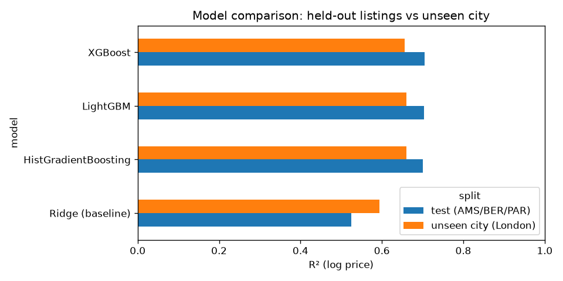
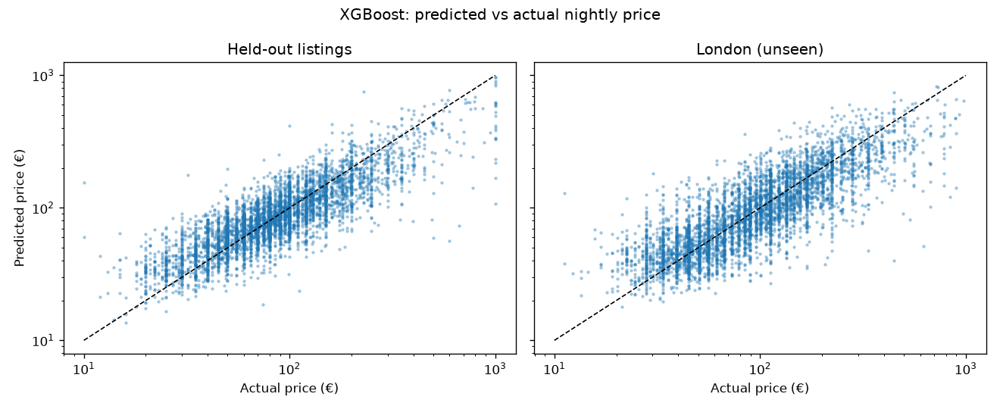
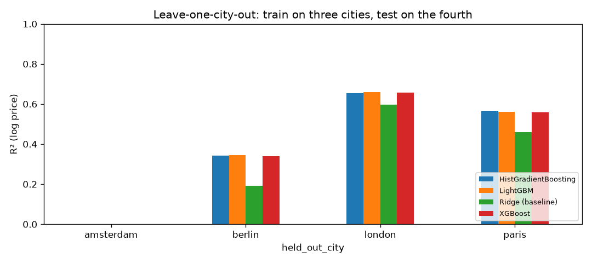
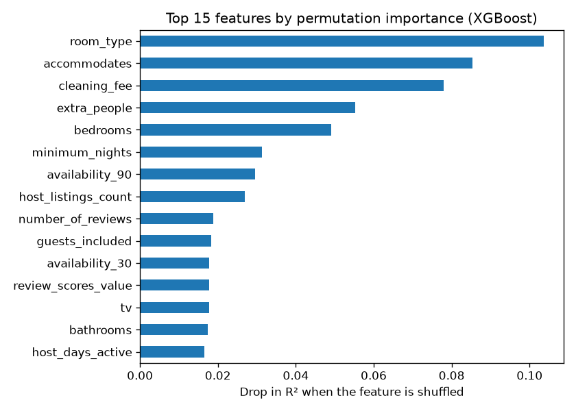

# Airbnb Price Prediction

[](https://github.com/divyam1101/AirbnbPricePrediction/actions/workflows/tests.yml)

Predicting the nightly price of Airbnb listings in **Amsterdam, Berlin, Paris and London** (about 190,000 listings), and measuring how well a model trained on some cities **transfers to a city it has never seen**.

## Problem

Hosts need a fair price for a listing, and a platform entering a new city has no local price history to learn from. Price depends on size, room type, amenities, host behaviour and reviews, and those relationships vary from city to city. Two questions follow:

1. How accurately can price be predicted for listings in cities we have data for?
2. How much accuracy is lost when the model is applied to a new city?

## Approach

| Step | What happens | Where |
|---|---|---|
| Cleaning | Raw Inside Airbnb snapshots → one row per listing: parsed money columns, binned review scores, 28 amenity flags matched on exact amenity names | [`preprocess.py`](src/airbnb_price/preprocess.py) |
| Features | All prices converted to **EUR** (London is in GBP); listings outside €10-€1,000/night excluded (applied to every city before any split); ordinal encodings for ordered bins; native categorical types | [`features.py`](src/airbnb_price/features.py) |
| Models | Ridge regression (baseline), scikit-learn HistGradientBoosting, LightGBM, XGBoost. Early stopping uses a validation slice of the **training** data | [`models.py`](src/airbnb_price/models.py) |
| Evaluation | (1) 80/20 hold-out on Amsterdam/Berlin/Paris + London as unseen city; (2) **leave-one-city-out** over all four cities. Metrics: R² and RMSE on log price, MAE in €, median % error | [`train.py`](src/airbnb_price/train.py) |
| Explanation | Permutation importance on held-out listings (model-agnostic) | [`train.py`](src/airbnb_price/train.py) |

## Results

191,742 listings in scope: London 83,173 · Paris 64,468 · Berlin 24,370 · Amsterdam 19,731.

### 1. Hold-out listings and London as an unseen city

Trained on 80% of Amsterdam, Berlin and Paris. Tested on the other 20%, and on all of London.

| Model | Test R² (log) | Test MAE | Test median error | London R² (log) | London MAE | London median error |
|---|---|---|---|---|---|---|
| Ridge (baseline) | 0.524 | €42.3 | 27.3% | 0.593 | €50.4 | 27.7% |
| HistGradientBoosting | 0.701 | €31.6 | 22.0% | 0.660 | €41.0 | 26.0% |
| LightGBM | 0.703 | €31.5 | 22.1% | 0.660 | €40.9 | 26.0% |
| **XGBoost** | **0.705** | **€31.3** | 22.1% | 0.656 | €41.2 | 26.2% |



- The three boosting libraries are effectively tied (R² within 0.004). All beat the linear baseline by about 0.18 R², cutting the typical error from 27% to 22% of the nightly price.
- For a listing in a city the model has seen, the typical prediction is within about **22% of the actual price**.



### 2. Leave-one-city-out: how well does the model transfer to a new city?

| Held-out city | Ridge R² | HistGB R² | LightGBM R² | XGBoost R² | LightGBM median error |
|---|---|---|---|---|---|
| Amsterdam | -0.43 | -0.20 | -0.22 | -0.23 | 36% |
| Berlin | 0.19 | 0.34 | 0.34 | 0.34 | 40% |
| Paris | 0.46 | 0.56 | 0.56 | 0.56 | 27% |
| London | 0.60 | 0.66 | 0.66 | 0.66 | 26% |



**Main finding:** the model learns *what makes a listing expensive within a city* well, but it cannot know a new city's overall **price level**. Amsterdam is the most expensive market (median €130/night vs €50 in Berlin). Trained on the other three cities, the model underprices typical Amsterdam listings by about 35% (actual price ≈ 1.55 × prediction) and overprices Berlin by about 37% (actual ≈ 0.73 × prediction). Removing that single city-wide offset lifts the held-out R² from -0.22 to 0.54 for Amsterdam and from 0.34 to 0.60 for Berlin.

**Recommendation for entering a new market:** keep the model, but calibrate it with a city-level price index (or a small sample of local listings) to set the price level. City GDP, which the 2021 version used, is not a substitute: it was a constant per city and cannot be learned from only three training cities.

### What drives price

Permutation importance of the XGBoost model on held-out listings (the drop in R² when a feature's values are shuffled):

| Rank | Feature | R² drop |
|---|---|---|
| 1 | Room type (entire home vs private/shared room) | 0.104 |
| 2 | Guests accommodated | 0.085 |
| 3 | Cleaning fee | 0.078 |
| 4 | Extra-guest fee | 0.055 |
| 5 | Bedrooms | 0.049 |
| 6 | Minimum nights | 0.031 |
| 7 | Availability over the next 90 days | 0.030 |
| 8 | Host's number of listings (professional hosts) | 0.027 |



Size and type of space dominate. The cleaning and extra-guest fees rank highly because hosts who charge more for these also charge more per night. They are legitimate inputs when a host is pricing a listing, but they partly reflect the host's own pricing level rather than the property itself. Among amenities, only TV appears in the top 15. Most amenity flags add little once size and room type are known.

## What changed from the 2021 version

The original notebooks are kept in [`notebooks/archive/`](notebooks/archive). Reviewing them turned up several problems that made the reported numbers unreliable:

| Problem in 2021 | Effect | Fix |
|---|---|---|
| London prices (GBP) compared directly with EUR prices | The "unseen city" test mixed currencies | Every money column converted to EUR |
| XGBoost early-stopped **on the test set** | Test score was tuned on the test set, so it was optimistic | Early stopping on a validation slice of the training data |
| Outliers removed from London using London's own mean and standard deviation | The test set was filtered with its own statistics | One fixed price scope (€10-€1,000) applied to every city up front |
| `fillna("unkown")` on the whole table | 30 numeric amenity columns turned into strings, then label-encoded as categories | Missing amenity = 0; numeric columns stay numeric |
| Zero prices replaced by 0.01 before taking logs | Extreme targets of log(0.01) = -4.6 | Zero and near-zero prices excluded by the price scope |
| City GDP used as a feature | A per-city constant, so it acted as a city ID that tree models cannot extrapolate to London | Dropped; generalisation measured with leave-one-city-out |
| Correlation filter computed on train + test rows | Feature selection saw the test data | Removed; the tree models handle correlated features |
| Amenity regexes such as `"pet"` and `"TV"` | False positives: "Pets live on this property" was counted as *pets allowed* | Exact amenity-name matching (affects re-processing raw data) |
| Preprocessing notebook needed SageMaker/S3, edited by hand per city | Not reproducible | Command-line module with unit tests |
| TabNet (deep learning) | Slow, and beaten by XGBoost in the original run | Dropped in favour of gradient-boosted trees, which current research finds stronger on tabular data |

**The new numbers are not directly comparable with the 2021 ones** (validation R² 0.75 for XGBoost, 0.63 on London). The old ones were inflated by the leaks above and mixed currencies. The new ones are the honest baseline.

## Run it

```bash
python -m venv .venv && source .venv/bin/activate     # Windows: .venv\Scripts\activate
pip install -e ".[dev]"
pytest -q                                              # unit tests
python -m airbnb_price.train                           # full experiment (~15-20 min on a laptop)
```

Outputs go to `reports/`: `metrics.json`, `feature_importance.csv` and the figures shown above.

To rebuild a cleaned city file from a raw [Inside Airbnb](http://insideairbnb.com/get-the-data/) snapshot:

```bash
python -m airbnb_price.preprocess listings.csv.gz data/paris_cleaned_v2.csv.gz --snapshot 2019-09-15
```

## Data

Listings data from [Inside Airbnb](http://insideairbnb.com/) (September 2019 snapshots), licensed under CC BY 4.0. The cleaned files in `data/` were produced by the 2021 preprocessing notebook.
